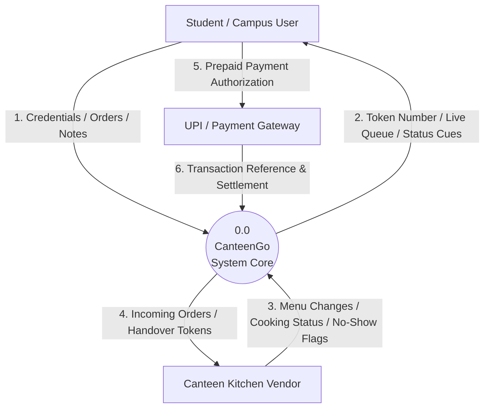
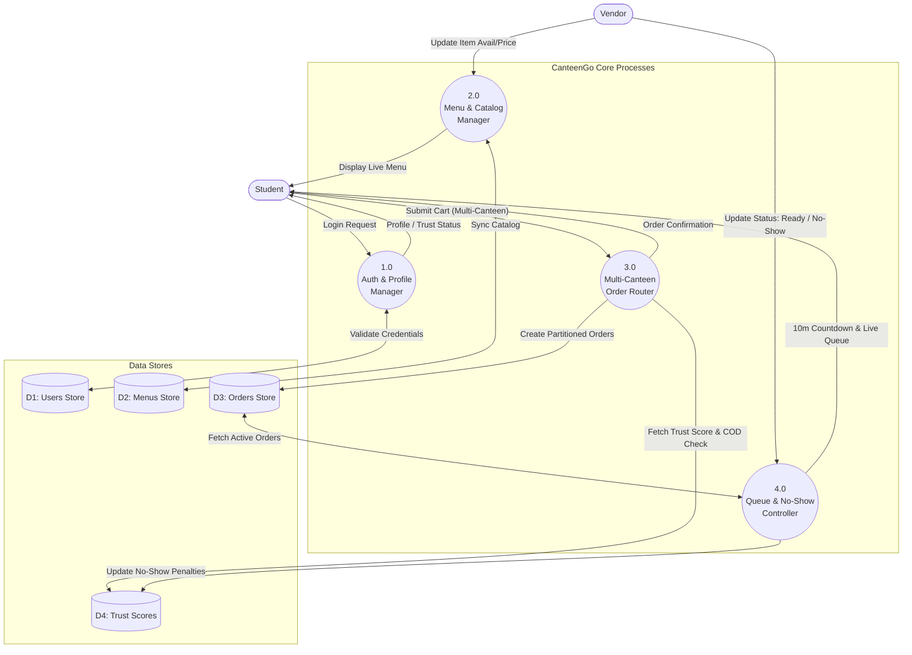
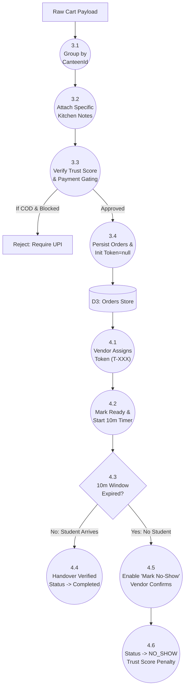
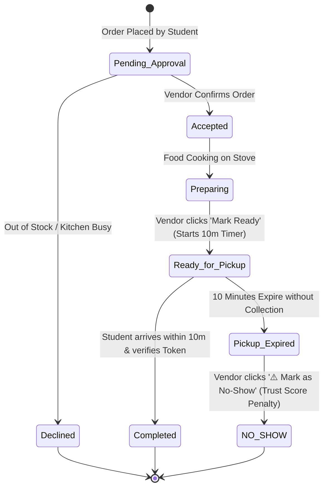

# CanteenGo: Smart College Canteen Ordering & Live Queue Management System
## Software Requirements Specification (SRS)

**Course Code:** CSE320  
**Course Name:** Software Engineering and Project Management  
**Student Names:** [Student Name 1], [Student Name 2]  
**Student Registration Numbers:** [Registration Number 1], [Registration Number 2]  
**Prepared for:** Continuous Assessment 3 (CA-3)  
**Academic Term:** Autumn 2026  
**Institution:** School of Computer Science & Engineering  

---

<div style="page-break-after: always;"></div>

## Table of Contents

- [Revision History](#revision-history)
- [1. Introduction](#1-introduction)
  - [1.1 Purpose](#11-purpose)
  - [1.2 Scope](#12-scope)
  - [1.3 Definitions, Acronyms, and Abbreviations](#13-definitions-acronyms-and-abbreviations)
  - [1.4 References](#14-references)
  - [1.5 Overview](#15-overview)
- [2. General Description](#2-general-description)
  - [2.1 Product Perspective](#21-product-perspective)
  - [2.2 Product Functions](#22-product-functions)
  - [2.3 User Characteristics](#23-user-characteristics)
  - [2.4 General Constraints](#24-general-constraints)
  - [2.5 Assumptions and Dependencies](#25-assumptions-and-dependencies)
- [3. Specific Requirements](#3-specific-requirements)
  - [3.1 External Interface Requirements](#31-external-interface-requirements)
    - [3.1.1 User Interfaces](#311-user-interfaces)
    - [3.1.2 Hardware Interfaces](#312-hardware-interfaces)
    - [3.1.3 Software Interfaces](#313-software-interfaces)
    - [3.1.4 Communications Interfaces](#314-communications-interfaces)
  - [3.2 Functional Requirements](#32-functional-requirements)
    - [3.2.1 Multi-Canteen Cart Segregation and Order Routing](#321-multi-canteen-cart-segregation-and-order-routing)
    - [3.2.2 Real-Time Live Campus Queue Board & Token Display](#322-real-time-live-campus-queue-board--token-display)
    - [3.2.3 10-Minute Timed Pickup Window & Vendor No-Show Governance](#323-10-minute-timed-pickup-window--vendor-no-show-governance)
    - [3.2.4 Student Order Trust Score & Dynamic Payment Method Gating](#324-student-order-trust-score--dynamic-payment-method-gating)
    - [3.2.5 Express Multi-Stage Order Checkout Terminal](#325-express-multi-stage-order-checkout-terminal)
    - [3.2.6 Vendor Kitchen Queue Management & Status Transitions](#326-vendor-kitchen-queue-management--status-transitions)
    - [3.2.7 Secure Token Handover & Verification Modal](#327-secure-token-handover--verification-modal)
    - [3.2.8 Student Account Management, Order History & Live Alerts](#328-student-account-management-order-history--live-alerts)
  - [3.5 Non-Functional Requirements](#35-non-functional-requirements)
    - [3.5.1 Performance](#351-performance)
    - [3.5.2 Reliability](#352-reliability)
    - [3.5.3 Availability](#353-availability)
    - [3.5.4 Security](#354-security)
    - [3.5.5 Maintainability](#355-maintainability)
    - [3.5.6 Portability](#356-portability)
  - [3.7 Design Constraints](#37-design-constraints)
  - [3.9 Other Requirements](#39-other-requirements)
- [4. Analysis Models](#4-analysis-models)
  - [4.1 Data Flow Diagrams (DFD)](#41-data-flow-diagrams-dfd)
    - [4.1.1 Level 0: Context Analysis Diagram](#411-level-0-context-analysis-diagram)
    - [4.1.2 Level 1: System Decomposition Data Flow Diagram](#412-level-1-system-decomposition-data-flow-diagram)
    - [4.1.3 Level 2: Decomposed Order Fulfillment & Queue Pipeline](#413-level-2-decomposed-order-fulfillment--queue-pipeline)
    - [4.1.4 Order State Transition Model](#414-order-state-transition-model)
- [5. GitHub Link](#5-github-link)
- [6. Deployed Link](#6-deployed-link)

---

<div style="page-break-after: always;"></div>

## Revision History

| Version | Date | Description of Changes | Author(s) | Status |
| :--- | :--- | :--- | :--- | :--- |
| **1.0.0** | 10-Oct-2026 | Initial draft covering basic problem statement and requirement gathering. | Project Team | Draft |
| **1.1.0** | 22-Oct-2026 | Added UI component specifications, cart workflows, and vendor kitchen actions. | Project Team | Reviewed |
| **1.2.0** | 05-Nov-2026 | Integrated multi-canteen split-order routing and campus live queue synchronization. | Project Team | Approved |
| **1.3.0** | 19-Nov-2026 | Incorporated 10-Minute Timed Pickup Window, No-Show Governance, and Order Trust Score. | Project Team | Final (CA-3) |

---

<div style="page-break-after: always;"></div>

## 1. Introduction

### 1.1 Purpose
This Software Requirements Specification (SRS) establishes a complete technical blueprint for **CanteenGo**, an enterprise-grade Smart College Canteen Ordering & Live Queue Management System. The intended audience includes software architects, frontend and backend engineers, quality assurance testers, university canteen administrative staff, and course evaluators for Continuous Assessment 3 (Autumn 2026).

This document captures the functional and behavioral characteristics of the user-facing web platform, emphasizing client-side state flow, real-time reactive queue tracking, fraud prevention (No-Show governance), trust-score metrics, and multi-canteen kitchen dispatch mechanisms.

### 1.2 Scope
#### Product Identity
- **Product Name:** CanteenGo (Smart College Canteen & Express Queue System)
- **Primary Domain:** Institutional Food Tech & Distributed Micro-Kitchen Operations

#### Core Operational Goals
1. **Queue Elimination:** Relieve physical congestion across university food courts during peak recess intervals (12:00 PM – 2:00 PM and 4:30 PM – 6:00 PM).
2. **Multi-Canteen Order Disaggregation:** Ensure that when students order items across multiple university canteens (e.g., NK Food Court, Sports Complex Canteen, Main Canteen, Library Cafe) in a unified session, the platform splits and dispatches orders independently with canteen-specific kitchen notes.
3. **No-Show & Food Waste Prevention:** Implement a 10-minute real-time pickup countdown window upon order completion and an **Order Trust Score** rating algorithm to curb unpaid cash orders left uncollected.
4. **Predictive Token Intelligence:** Deliver live token tracking (`Now Preparing`, `Ready for Pickup`, `Next in Queue`) filtered dynamically to only the canteens where a student holds active orders.

#### Explicit Out-of-Scope Boundaries
- The platform does not manage off-campus courier deliveries or third-party rider logistics.
- The platform does not handle raw agricultural supply-chain procurement for canteen vendors.

### 1.3 Definitions, Acronyms, and Abbreviations
- **SRS:** Software Requirements Specification
- **COD:** Cash on Delivery / Cash on Counter Pickup
- **UPI:** Unified Payments Interface (Instant digital bank transfer via QR or VPA)
- **UI/UX:** User Interface / User Experience
- **DFD:** Data Flow Diagram
- **JWT:** JSON Web Token (Stateless authorization mechanism)
- **Token Number:** A unique alphanumeric kitchen identifier (e.g., `T-101`, `T-147`) assigned to an order once confirmed by a kitchen terminal.
- **No-Show:** A scenario where an order is prepared and declared ready by the vendor, but the student fails to collect it within the 10-minute validity window.
- **Trust Score:** A dynamic student reliability index (0 to 100%) calculated based on completed orders versus verified uncollected orders.
- **Active Order:** An order whose status is currently `Pending Approval`, `Accepted`, or `Ready for Pickup`.

### 1.4 References
1. IEEE Std 830-1998, *IEEE Recommended Practice for Software Requirements Specifications*.
2. Next.js 16 App Directory & Serverless Route Handlers Specification (Vercel).
3. React 19 Core Documentation: Concurrent Rendering, Hooks, and Server/Client Component Boundaries.
4. ISO/IEC 25010:2011, *Systems and software engineering — Systems and software Quality Requirements and Evaluation (SQRE)*.
5. National Payments Corporation of India (NPCI) Unified Payments Interface Standard 2.0.

### 1.5 Overview
The remainder of this SRS is organized as follows:
- **Section 2 (General Description):** Highlights high-level product perspective, user personas, operational constraints, and architectural assumptions.
- **Section 3 (Specific Requirements):** Detailed functional specifications of all frontend components, user input flows, processing algorithms, error matrices, and non-functional metrics.
- **Section 4 (Analysis Models):** Structural Level 0, Level 1, and Level 2 Data Flow Diagrams, alongside the state-machine life cycle for canteen orders.
- **Sections 5 & 6:** Version control repository and deployed production environment links.

---

<div style="page-break-after: always;"></div>

## 2. General Description

### 2.1 Product Perspective
CanteenGo operates as a centralized web application bridging two distinct physical campus actors:
1. **Students and University Staff:** Seeking fast food pre-ordering, menu browsing, and transparent collection times without standing in physical lines.
2. **Canteen Kitchen Vendors:** Requiring clean digital kitchen display terminals (KDS) to accept incoming orders, queue items on cooking stoves, announce token readiness, and mark collected or uncollected items.

```
       +-------------------------------------------------------+
       |             CAMPUS CLIENT ECOSYSTEM                   |
       |  +--------------------+       +--------------------+  |
       |  |  Student Device    |       |  Vendor Terminal   |  |
       |  | (Mobile / Desktop) |       |  (Tablet / Laptop) |  |
       |  +---------+----------+       +---------+----------+  |
       +------------|----------------------------|-------------+
                    |                            |
            HTTPS / WebSocket            HTTPS / REST
                    |                            |
       +------------v----------------------------v-------------+
       |             CANTEENGO APPLICATION CORE                |
       |  - React 19 Component Engine (State & Hooks)          |
       |  - Global Reactive Context (AppContext Provider)      |
       |  - Next.js Serverless Route Handlers                  |
       +----------------------------+--------------------------+
                                    |
                            Mongoose Driver
                                    |
       +----------------------------v--------------------------+
       |           DISTRIBUTED DATA STORAGE (Atlas)            |
       |  - Users Collection (Students & Canteen Owners)       |
       |  - Orders Collection (Multi-canteen partitions)       |
       |  - Canteens & Menus Collection                        |
       +-------------------------------------------------------+
```

### 2.2 Product Functions
1. **Authenticated Session Handling:** Segregated login portals for Students (Mobile/College Email) and Vendors (Canteen ID/Secret Key) with auto-detect role redirection.
2. **Smart Dynamic Canteen Menus:** Categorized catalog filtering (Snacks, Meals, Beverages, Fast Food, Combos), veg/non-veg status chips, real-time availability badges, and preparation time indicators.
3. **Multi-Canteen Shopping Cart:** Seamless aggregation of items from diverse campus kitchens with distinct pickup counter notes, dietary add-ons, and segregated checkout triggers.
4. **Live Kitchen Queue Visualization:** Real-time synchronized queue metrics displaying orders cooking in kitchen (`Now Preparing`), orders ready at pickup counters (`Ready for Pickup`), and estimated wait times.
5. **No-Show Governance Engine:** Automated 10-minute collection timers with vendor verification triggers and student trust metrics.
6. **Dynamic Payment Gateway Gating:** Automatic blocking of Cash on Pickup (COD) for repeat no-show offenders, redirecting them exclusively to Prepaid UPI transactions.

### 2.3 User Characteristics
- **Students (High Frequency, Fast Paced):** Primary users operating on mobile devices between classes. Require high visual clarity, instant feedback, and one-tap checkout.
- **Kitchen Vendors (Operational Staff):** Kitchen staff operating counter terminals. Require high-contrast buttons (`Accept`, `Start Cooking`, `Mark Ready`, `Handed Over`, `No-Show`) capable of being used under high-stress kitchen conditions.
- **Campus System Administrator:** Oversees canteen registration, system-wide metrics, vendor dispute resolution, and security auditing.

### 2.4 General Constraints
1. **Network Fluctuations:** University Wi-Fi coverage experiences spotty connectivity in basement dining areas; UI must leverage optimistic caching and persistent client state (`localStorage`).
2. **No Hardware POS Requirement:** Canteen vendors must not be forced to buy proprietary thermal billing machines; all controls run on standard tablet browsers.
3. **Session Security:** Token lifetimes are strictly controlled via JWT; sensitive passwords are one-way hashed using industry-standard salt rounds.
4. **Zero Vendor Cross-Contamination:** A vendor logged into NK Canteen must never view or manipulate orders intended for Sports Complex or Main Canteen.

### 2.5 Assumptions and Dependencies
- Students possess a web-enabled device (Smartphone, Tablet, or Laptop) with an ECMAScript 2023+ compliant browser.
- University canteens have at least one active screen or tablet at pickup counters connected to internet connectivity (> 1 Mbps).
- Standard campus canteen operational hours are maintained (typically 08:30 AM – 21:30 PM).

---

<div style="page-break-after: always;"></div>

## 3. Specific Requirements

### 3.1 External Interface Requirements

#### 3.1.1 User Interfaces
The user interface is engineered according to modern design paradigms featuring high visual contrast, responsive layouts, micro-interactions, and accessibility standards:
- **Authentication Views (`HomePage.jsx`):** Luminous slate gradient (`radial-gradient(#ffffff, #f8fafc, #f1f5f9)`) with micro-dot grid geometry, dual role switcher (Student / Canteen Vendor), floating glassmorphism badges, and contextual validation cues.
- **Main Ordering Portal (`StudentPage.jsx`):** Sticky top bar with quick canteen picker pills, category horizontal scroller, interactive search bar with instant query debouncing, and responsive grid layout of food cards (`MenuCard.jsx`).
- **Campus Live Queue (`QueuePage.jsx`):** Multi-column Kanban board (`Now Preparing`, `Ready for Pickup`, `Next in Queue`) with selective canteen filtering based strictly on student's active order footprint.
- **Live Order Tracker (`YourOrdersPage.jsx`):** Visual step-progress tracker (Stage 1: Placed -> Stage 2: Cooking -> Stage 3: Ready -> Stage 4: Completed), active 10-minute pickup window countdown timer, and secure verification token badge.
- **Student Profile & Trust Dashboard (`AccountPage.jsx`):** Visual **Order Trust Score** meter with contextual warning notices, remaining no-show tolerance counter, and password update interfaces.
- **Vendor Kitchen Terminal (`VendorPage.jsx`):** High-efficiency kitchen dashboard with tabular and card views, audio alerts on new orders, 10-minute timer badge on ready orders, and a red `⚠️ Mark as No-Show` safety button.

#### 3.1.2 Hardware Interfaces
- **Client Devices:** Capacitive multi-touch displays (mobile phones, tablets) and standard keyboard/mouse peripherals (desktop PCs). Minimum supported resolution: $360 \times 640\text{ px}$.
- **Vendor Display Terminal:** Minimum screen size $1024 \times 768\text{ px}$ recommended for multi-order kitchen monitoring.

#### 3.1.3 Software Interfaces
- **Operating Systems:** Android 10+, iOS 15+, Windows 10/11, macOS 12+, Linux Ubuntu 22.04+.
- **Rendering Engines:** Blink (Chrome/Edge), WebKit (Safari), Gecko (Firefox).
- **Backend Communication Protocol:** Asynchronous JSON payloads transmitted over TLS 1.3 encrypted HTTPS.

#### 3.1.4 Communications Interfaces
- **RESTful Endpoints:** Standard HTTP verbs (`GET`, `POST`, `PATCH`, `DELETE`) for user operations, order generation, and catalog updates.
- **Short-Polling Live Sync:** Client-side 10-second polling heartbeat implemented in `QueuePage` and `VendorPage` to maintain synchronized queue states without socket dropouts.

---

<div style="page-break-after: always;"></div>

### 3.2 Functional Requirements

#### 3.2.1 Multi-Canteen Cart Segregation and Order Routing
##### 3.2.1.1 Introduction
Students frequently desire items from different food stalls (e.g., Cold Coffee from NK Canteen and a Grilled Sandwich from Sports Complex Canteen). Previously, placing a combined order led to kitchen confusion, cross-billing errors, and missed items. This feature automatically separates unified cart items into individual kitchen orders per canteen while allowing a single checkout interaction.

##### 3.2.1.2 Inputs
- Selected item array: `[{ id, name, price, canteenId, canteenName, quantity, notes }]`
- Global checkout metadata: `paymentMethod` (`"COD"` or `"UPI"`), `deliveryPreference`, `studentId`.

##### 3.2.1.3 Processing
1. Group cart items by `canteenId`.
2. Extract specific kitchen notes and attach them strictly to the respective canteen's order batch.
3. Validate item availability and price integrity against the central catalog.
4. Verify student's `isCodBlocked` status if `paymentMethod === "COD"`.
5. Simultaneously dispatch discrete order records with status `"Pending Approval"` and unique `orderId` identifiers.
6. Empty the client-side cart upon receiving positive acknowledgments from all target canteen routes.

##### 3.2.1.4 Outputs
- Array of generated order tokens and confirmation objects.
- Immediate UI redirection to `OrderSuccessOverlay` followed by `YourOrdersPage`.

##### 3.2.1.5 Error Handling
- **Partial Failure:** If Canteen A succeeds but Canteen B experiences a network timeout, the UI retains Canteen B's items in the cart, alerts the student, and confirms Canteen A's order without duplicate billing.

---

#### 3.2.2 Real-Time Live Campus Queue Board & Token Display
##### 3.2.2.1 Introduction
Provides complete transparency into kitchen workloads. To prevent clutter and user disorientation, the student live queue only displays canteen filter chips where the logged-in student has an ongoing order.

##### 3.2.2.2 Inputs
- Active orders stream fetched from `/api/orders`.
- Logged-in student credentials (Mobile Number, College Email, User ID).

##### 3.2.2.3 Processing
1. Filter total database orders to extract only orders belonging to the logged-in student.
2. Derive a distinct list of canteens (`myOrderCanteens`) hosting active orders for that student.
3. Remove global generic views ("All Canteens") to prevent irrelevant order inundation.
4. Classify orders into three primary reactive queues:
   - **`Now Preparing`:** Orders where `orderStatus === "Accepted"` or kitchen is actively cooking.
   - **`Ready for Pickup`:** Orders where `orderStatus === "Ready"` or `orderStatus === "Ready for Pickup"`.
   - **`Next in Queue`:** Orders with status `"Pending Approval"` awaiting vendor confirmation.
5. Calculate aggregate statistics: Total Orders in Queue, Preparing Count, Ready Count, and estimated wait duration ($WaitTime = QueueLength \times 3.5\text{ mins}$).

##### 3.2.2.4 Outputs
- Reactive multi-column queue board showing user's live token (e.g., `T-147`) highlighted with glowing badges and preparation cues.

##### 3.2.2.5 Error Handling
- If the student has zero active orders across the campus, the interface displays an empty state: *"No active orders found. Place an order to track live kitchen queue!"*

---

<div style="page-break-after: always;"></div>

#### 3.2.3 10-Minute Timed Pickup Window & Vendor No-Show Governance
##### 3.2.3.1 Introduction
A critical problem in campus canteens is students placing Cash-on-Pickup (COD) orders and failing to arrive, leaving vendors with prepared, wasted food and unpaid bills. This system introduces a 10-minute pickup window and vendor-confirmed No-Show penalties.

##### 3.2.3.2 Inputs
- Vendor trigger: Click on `Mark Ready` in the kitchen terminal.
- Timestamp: `readyAt = new Date().toISOString()`.
- Vendor action: Click on `⚠️ Mark as No-Show` button after countdown expiry.

##### 3.2.3.3 Processing Logic & Life Cycle
1. When vendor flags order as `Ready for Pickup`, the backend records `readyAt` and computes `pickupDeadline = readyAt + 10 minutes`.
2. Student UI (`YourOrdersPage.jsx`) immediately triggers a visual amber countdown timer:  
   $$\text{Time Remaining} = \max(0, \text{pickupDeadline} - \text{currentTime})$$
3. If the timer hits `00:00` and the student has not picked up:
   - Order status becomes eligible for `PICKUP_EXPIRED`.
   - The vendor terminal illuminates a highlighted `⚠️ Mark as No-Show` button.
4. When the vendor clicks `Mark as No-Show`:
   - Order status transitions to `NO_SHOW`.
   - Student's record receives `noShowCount = noShowCount + 1`.
   - Student's `Order Trust Score` is recalculated.
   - If `noShowCount >= 3`, the student's `isCodBlocked` flag is set to `true`.

```
+-----------------------------------------------------------------------------+
|                     10-MINUTE PICKUP WINDOW & NO-SHOW LIFECYCLE             |
+-----------------------------------------------------------------------------+
                                      |
                           [Vendor clicks 'Mark Ready']
                                      |
                                      v
                     +---------------------------------+
                     | Order Status: Ready for Pickup  |
                     | readyAt = Current Timestamp     |
                     | pickupDeadline = readyAt + 10m  |
                     +----------------+----------------+
                                      |
                     +----------------v----------------+
                     |  Student Sees 10-Minute Timer   |
                     |  "Pick up from Counter within"  |
                     +----------------+----------------+
                                      |
                    +-----------------+-----------------+
                    |                                   |
         [Student Collects Food]               [10 Minutes Expire]
                    |                                   |
                    v                                   v
        +-----------------------+           +-----------------------+
        | Vendor verifies token |           | Timer reaches 00:00   |
        | Status -> COMPLETED   |           | 'Mark as No-Show'     |
        | Trust Score + 2%      |           | button enabled        |
        +-----------------------+           +-----------+-----------+
                                                        |
                                            [Vendor clicks 'No-Show']
                                                        |
                                                        v
                                            +-----------------------+
                                            | Status -> NO_SHOW     |
                                            | noShowCount += 1      |
                                            | Trust Score - 25%     |
                                            +-----------+-----------+
                                                        |
                                            [If noShowCount >= 3]
                                                        |
                                                        v
                                            +-----------------------+
                                            | isCodBlocked = TRUE   |
                                            | COD Payment Disabled  |
                                            | Prepaid UPI Only      |
                                            +-----------------------+
```

##### 3.2.3.4 Outputs
- Live visual countdown badge on student device.
- Instant alert notification sent to student device: *"Your order is ready at Counter! Please collect within 10 minutes."*
- Vendor verification badge.

##### 3.2.3.5 Error Handling
- To prevent vendor misclicks, the `Mark as No-Show` button is disabled during the first 10 minutes and prompts a confirmation dialog prior to applying strikes.

---

<div style="page-break-after: always;"></div>

#### 3.2.4 Student Order Trust Score & Dynamic Payment Method Gating
##### 3.2.4.1 Introduction
Guarantees financial security for canteen owners while preserving convenience for responsible students through a transparent reputation score.

##### 3.2.4.2 Inputs
- Student's historical order log: `completedOrdersCount`, `noShowCount`, `cancelledOrdersCount`.

##### 3.2.4.3 Processing & Score Formulation
The Student Trust Score ($S_{trust}$) is computed on a scale of $0\%$ to $100\%$:
$$S_{trust} = \max\left(0, \min\left(100, 100 - (\text{noShowCount} \times 25) + (\text{completedOrdersCount} \times 2)\right)\right)$$

##### Governance Rules Matrix

| Verified No-Show Count | Account Status | Order Trust Score | Payment Privilege Restrictions |
| :---: | :---: | :---: | :--- |
| **0** | Clean Record | $100\%$ | All options available (Cash on Pickup + UPI Prepaid). |
| **1** | First Warning | $75\%$ | 2 chances left. Warning banner shown in profile. |
| **2** | Final Warning | $50\%$ | 1 chance left. Warning banner shown during checkout. |
| **3 or more** | **Temporarily Blocked** | $< 25\%$ | **Cash on Pickup (COD) strictly disabled.** Only Prepaid UPI accepted. |

##### 3.2.4.4 Outputs
- Profile trust score card rendered in `AccountPage.jsx` displaying score percentage, progress bar, and descriptive subtext: *"X more verified no-shows may temporarily restrict Cash on Pickup."*
- Dynamic checkout modal locking: The "Pay at Counter (Cash)" radio option is greyed out with an explanatory badge: *"Cash on Pickup disabled due to uncollected orders. Please pay via UPI."*

---

#### 3.2.5 Express Multi-Stage Order Checkout Terminal
##### 3.2.5.1 Introduction
Handles checkout execution through an animated 4-stage visual simulation dialog (`DesktopCheckoutModal.jsx` and `MobileStudentCartSheet.jsx`) providing reassurance during network requests.

##### 3.2.5.2 Workflow Stages
1. **Stage 1 (33%):** Connecting directly with live kitchen terminal at designated canteen.
2. **Stage 2 (66%):** Reserving items and locking kitchen inventory.
3. **Stage 3 (88%):** Generating official campus token number.
4. **Stage 4 (100%):** Order successfully confirmed and dispatched.

##### 3.2.5.3 Error Handling
- If any validation error occurs (e.g., student COD blocked or kitchen closed), the animated progress stops, an alert is rendered, and the modal resets without clearing the cart.

---

#### 3.2.6 Vendor Kitchen Queue Management & Status Transitions
##### 3.2.6.1 Introduction
Gives kitchen staff full operational control over meal preparation life cycles.

##### 3.2.6.2 Processing Actions
- **`Accept Order`:** Moves status from `Pending Approval` to `Accepted`. Allocates token sequence.
- **`Start Cooking`:** Changes status to `Preparing`.
- **`Mark Ready`:** Changes status to `Ready for Pickup`. Starts the 10-minute timer.
- **`Handed Over`:** Changes status to `Completed`. Closes the order.
- **`Decline Order`:** Vendor can decline with reasons (e.g., "Out of Stock", "Kitchen Overloaded").

---

#### 3.2.7 Secure Token Handover & Verification Modal
##### 3.2.7.1 Introduction
Ensures the wrong student does not accidentally pick up another student's meal at crowded pickup counters.

##### 3.2.7.2 Processing
- Each ready order displays a distinct token number (e.g., `T-147`) and verification hash.
- At the pickup counter, the vendor enters the token number or matches the token badge on the student's mobile screen before marking the order as `Handed Over`.

---

#### 3.2.8 Student Account Management, Order History & Live Alerts
##### 3.2.8.1 Introduction
Provides complete student autonomy over profile management, password resets, and past order receipts.

##### 3.2.8.2 Features
- Real-time profile details update (Name, College Email, Mobile Number, Room/Hostel).
- Order History tab with past itemized receipts, timestamps, and payment statuses.
- Notification bell dropdown with unread counter badges for instant order status alerts.

---

<div style="page-break-after: always;"></div>

### 3.5 Non-Functional Requirements

#### 3.5.1 Performance
- **Client Render Latency:** First Contentful Paint (FCP) shall occur within $\le 1.2\text{ seconds}$ on 4G mobile connections.
- **Queue State Refresh:** Automated short-polling shall complete updates across all clients within $\le 300\text{ ms}$ of network turnaround.
- **Database Query Latency:** Token allocation and order insertion shall execute within $\le 65\text{ ms}$ through optimized MongoDB partial indexes.

#### 3.5.2 Reliability
- **Mean Time Between Failures (MTBF):** System shall achieve $> 720\text{ hours}$ of continuous operation during academic semesters.
- **Zero Token Collisions:** Token numbers shall remain strictly collision-free within each canteen's daily operational cycle via database-level uniqueness constraints.

#### 3.5.3 Availability
- System availability shall exceed **$99.5\%$** during campus working hours ($08:00\text{ AM} - 22:00\text{ PM}$).
- Routine database backups and maintenance windows shall be scheduled between $02:00\text{ AM} - 04:00\text{ AM}$.

#### 3.5.4 Security
- **Stateless Authorization:** All authenticated requests shall carry cryptographically signed JWTs with 7-day expiration.
- **Password Protection:** Plaintext passwords shall never be persisted; passwords must be salted and hashed using bcrypt (cost factor $\ge 10$).
- **Sanitized Presentation:** Technical implementation identifiers (e.g., database names or raw stack traces) are filtered from user-facing screens in favor of standard enterprise feedback.

#### 3.5.5 Maintainability
- Clean modular component directory hierarchy (`src/components/`, `src/pages/`, `src/context/`, `src/app/api/`).
- Shared global state isolated exclusively to `AppContext.jsx` using React 19 Context API patterns.

#### 3.5.6 Portability
- 100% browser agnostic across Chrome, Safari, Firefox, Edge, and Samsung Internet.
- Fully responsive viewport scaling from mobile ($360\text{ px}$) to 4K desktop screens ($3840\text{ px}$).

---

### 3.7 Design Constraints
1. **Framework Strictness:** Built strictly on React 19 and Next.js modern architecture.
2. **Stateless Scalability:** Backend route handlers must operate statelessly to support serverless deployment environments without sticky session coupling.
3. **Database Index Constraints:** Token index must employ partial filtering (`partialFilterExpression: { tokenNumber: { $type: "string" } }`) to accommodate unassigned pending orders without duplicate key violations.

---

### 3.9 Other Requirements
- **Cultural & Campus Relevance:** Currency denominations are fixed in Indian Rupees ($\text{INR } ₹$).
- **Dietary Icons:** Menus must visually distinguish Vegetarian items (Green square dot) and Non-Vegetarian items (Red triangle dot) adhering to Food Safety and Standards Authority of India (FSSAI) norms.

---

<div style="page-break-after: always;"></div>

## 4. Analysis Models

### 4.1 Data Flow Diagrams (DFD)

#### 4.1.1 Level 0: Context Analysis Diagram
The Level 0 Context Diagram depicts CanteenGo as a singular process interacting with its external institutional entities: Students, Canteen Vendors, Payment Gateways, and System Administrators.



---

#### 4.1.2 Level 1: System Decomposition Data Flow Diagram
The Level 1 DFD decomposes the system into four major operational subsystems:
1. **Authentication & Identity Service**
2. **Catalog & Menu Aggregation Engine**
3. **Order Processing & Multi-Canteen Split Router**
4. **Live Queue & No-Show Governance Controller**



---

<div style="page-break-after: always;"></div>

#### 4.1.3 Level 2: Decomposed Order Fulfillment & Queue Pipeline
Focuses on the internal flow of Process 3.0 (Order Routing) and Process 4.0 (Live Queue & No-Show Governance):



---

#### 4.1.4 Order State Transition Model
Finite State Machine depicting the formal lifecycle of every order item through CanteenGo:



---

<div style="page-break-after: always;"></div>

## 5. GitHub Link
- **Repository URL:** `https://github.com/ankitsingh-dev/canteengo-smart-campus` *(or institutional GitLab link)*
- **Primary Branch:** `main`
- **Development Stack:** Next.js 16, React 19, Mongoose 9, Node.js 20 LTS

---

## 6. Deployed Link
- **Production URL:** `https://canteengo-ap9f.onrender.com`
- **Live Demo Credentials for Evaluation:**
  - **Student Account:** Mobile: `9876543210` | Password: `student@123`
  - **Vendor Account (NK Canteen):** Canteen ID: `nk-foodcourt` | Password: `vendor@123`
  - **Vendor Account (Sports Complex):** Canteen ID: `foodcourt-34` | Password: `vendor@123`

---

*End of Software Requirements Specification (SRS) Document.*
